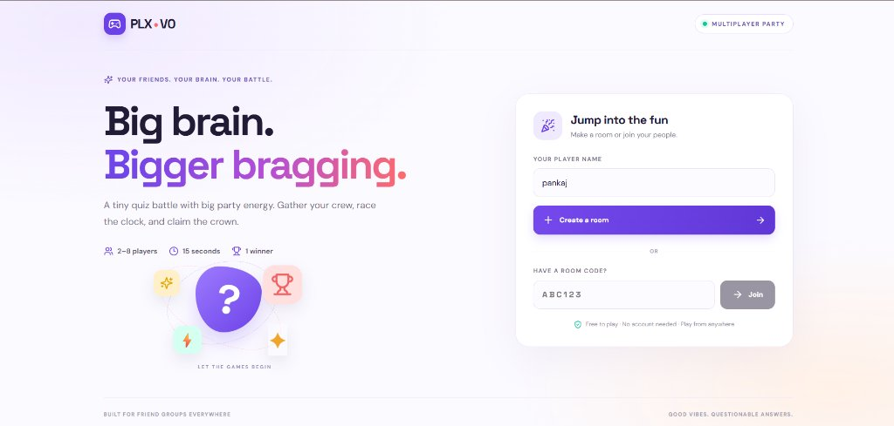

# PLX-V0 — Multiplayer Quiz Battle 🎮

A responsive, colorful quiz game for **2–8 players**. Three rounds, five questions per round, 15 seconds per question, 1,000 base points plus a server-calculated speed bonus of up to 500.

> **Think fast. Beat your friends. Own the leaderboard.**



## ✨ Features

- 🎯 **Real multiplayer & Solo Warm-up** — Play 1-player solo warmup sessions or 2–8 player party battles
- 📧 **Email ID Verification for Solo Warm-up** — Secure 6-digit verification code (OTP) required to unlock solo warm-up sessions
- 📊 **Difficulty Levels & Categories** — Level 1 (Warm-up), Level 2 (Brain Rush), Level 3 (Final Showdown) across Science, Geography, History, Tech, Math, Art, Space & Nature
- 📱 **Responsive design** — Optimized for phones, tablets, and desktops
- 🔒 **Server-authoritative** — All scoring, validation, and answer reveals are server-side
- ⚡ **Speed bonus** — Faster correct answers earn more points (up to 1,500 per question)
- 🔄 **Reconnection** — Drop out and rejoin without losing your score
- 🎉 **Confetti celebration** — Canvas-based confetti on the winner/finish screen
- 🏆 **Live leaderboard** — Rankings update in real-time during play
- 🔐 **No answer leaks** — Correct answers are never sent until the reveal phase

## 🎮 Game Rules & Structure

| Mode | Description |
|---|---|
| **🎯 Solo Warm-up** | Instant 1-player practice session to sharpen your speed and accuracy |
| **👥 Multiplayer Battle** | 2–8 players compete in real-time for leaderboard supremacy |
| **📊 Level 1: Warm-up** | Questions 1–5 · Approachable trivia to get in the zone |
| **🔥 Level 2: Brain Rush** | Questions 6–10 · Medium difficulty, faster pace |
| **👑 Level 3: Showdown** | Questions 11–15 · Harder questions, decisive points |
| **⏱️ Timer** | 15 seconds per question |
| **Points** | 1,000 base + up to 500 speed bonus |
| **Wrong / Timeout** | 0 points |

### Speed Bonus Formula

```
bonus = floor(500 × remaining_ms / 15000)
total = 1000 + bonus
```

Example: Correct answer with 10 seconds left → 1,000 + 333 = **1,333 points**

## 🚀 Quick Start

### Prerequisites

- Node.js 20+ (LTS recommended)
- A Netlify account (for multiplayer — the backend requires Netlify Functions + Blobs)

### Local Development

```bash
# Install dependencies
npm install

# Run tests (no network needed)
npm run test:game

# Start the UI dev server (frontend only)
npm run dev

# Run full standalone multiplayer server (Frontend + Game API on port 3000):
npm run build
npm start
```

### 🐳 Run with Docker

The application comes with complete Docker support and runs completely self-contained on port `3000` with no external dependencies required!

#### Option 1: Docker Compose (Recommended)

```bash
docker compose up --build
```
Then visit `http://localhost:3000` in your browser.

#### Option 2: Docker CLI

```bash
# Build the image
docker build -t plx-game .

# Run container
docker run -d -p 3000:3000 --name plx plx-game
```
Access the game at `http://localhost:3000`.

### Deploy to Netlify

1. Create or sign in to a [Netlify](https://netlify.com) account.
2. Connect this repo or drag-and-drop the project folder.
3. Netlify detects `netlify.toml`, runs `npm run build`, publishes `dist/`, and packages the function.
4. Open the HTTPS URL in two browsers/devices. Create a room, join with the code, play all 15 questions.
5. Verify scores and the winner before sharing publicly.

## 📡 API Reference

All game actions use **`POST /.netlify/functions/game`** with JSON:

| Action | Payload | Description |
|--------|---------|-------------|
| `create` | `{ "action": "create", "name": "Alice" }` | Create a new room |
| `join` | `{ "action": "join", "name": "Bob", "code": "ABC234" }` | Join an existing room |
| `state` | `{ "action": "state", ...session }` | Poll current game state |
| `start` | `{ "action": "start", ...session }` | Host starts the match |
| `answer` | `{ "action": "answer", "option": 0, ...session }` | Submit an answer (0–3) |
| `leave` | `{ "action": "leave", ...session }` | Leave the room |

The `session` object (`roomCode`, `playerId`, `token`) is returned on create/join. Keep the token private.

## 🏗️ Architecture

```
┌─────────────────────────────────┐
│  Mobile / Desktop Browser       │
│  React + TypeScript + Vite      │
│  Lobby · Quiz · Timer · Scores  │
└──────────┬──────────────────────┘
           │ HTTPS POST (polling ~900ms)
           ▼
┌─────────────────────────────────┐
│  Netlify Function — game.ts     │
│  Validate · Score · Enforce     │
│  Optimistic concurrency (ETag)  │
└──────────┬──────────────────────┘
           │ Strong consistency
           ▼
┌─────────────────────────────────┐
│  Netlify Blobs                  │
│  Room state · Sessions · Scores │
│  ETag-based conditional writes  │
└─────────────────────────────────┘
```

### Concurrency Model

- **Optimistic locking**: Every room write uses `onlyIfMatch` (ETag) to detect conflicts.
- **Automatic retry**: Failed writes (ConcurrencyError) retry up to 3 times with backoff.
- **Room creation**: Uses `onlyIfNew` to prevent code collisions.

## ⚠️ Production Readiness Note

This implementation uses ETag-based optimistic concurrency, which handles typical quiz traffic well. However:

- Under very high concurrent load (many players answering simultaneously), some requests may need client-side retry.
- For adversarial or high-scale use, consider moving room state to a transactional database.
- The polling model (~900ms) provides near-real-time updates but is not true WebSocket-level latency.

## 📁 Project Structure

```
plx-v0/
├── index.html                    # Entry point
├── netlify.toml                  # Netlify build/function config
├── package.json                  # Dependencies and scripts
├── vite.config.ts                # Vite configuration
├── tsconfig.json                 # TypeScript config
├── src/
│   ├── main.tsx                  # React entry
│   ├── App.tsx                   # Main game component
│   ├── types.ts                  # Shared TypeScript types
│   └── styles.css                # Complete stylesheet
├── netlify/
│   ├── functions/
│   │   └── game.ts               # Serverless game API
│   └── lib/
│       └── questions.mjs         # 15 quiz questions
└── tests/
    └── game.test.mjs             # Game logic tests
```

## 📄 License

MIT
